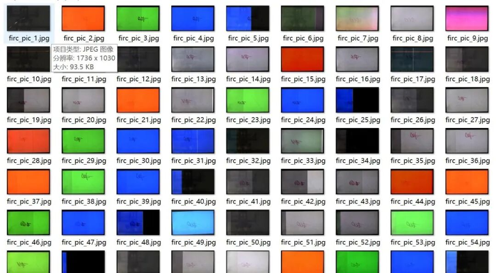
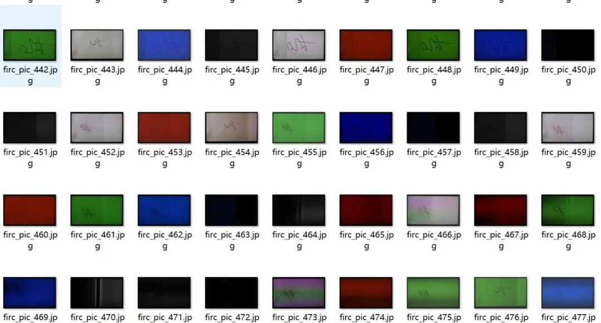
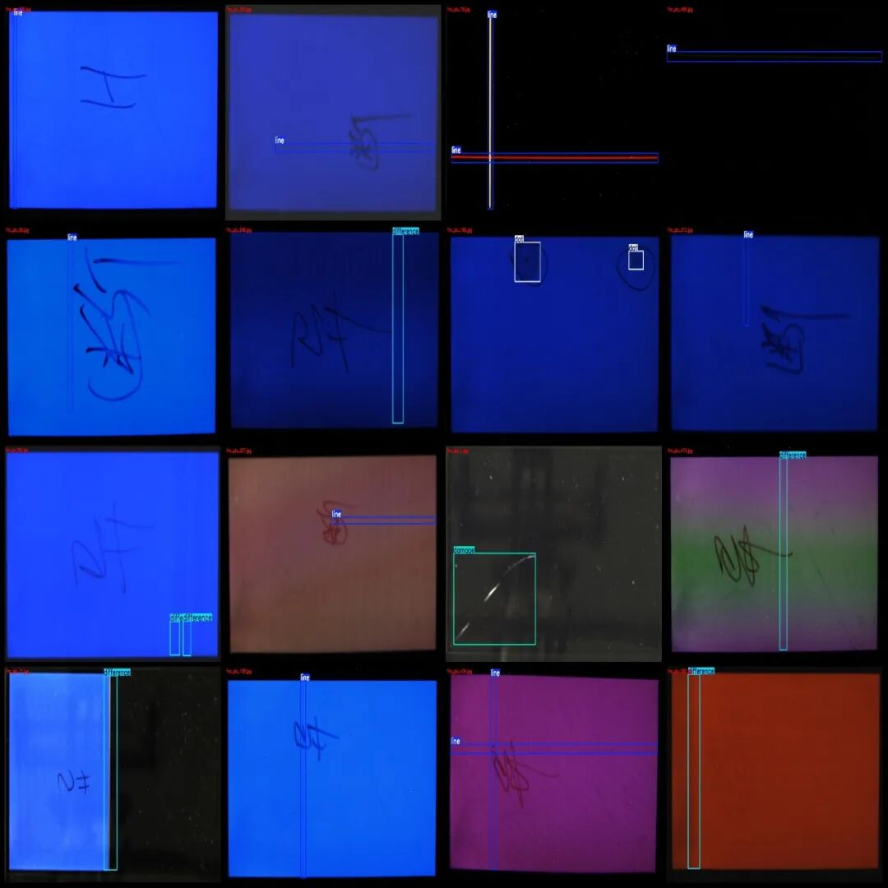
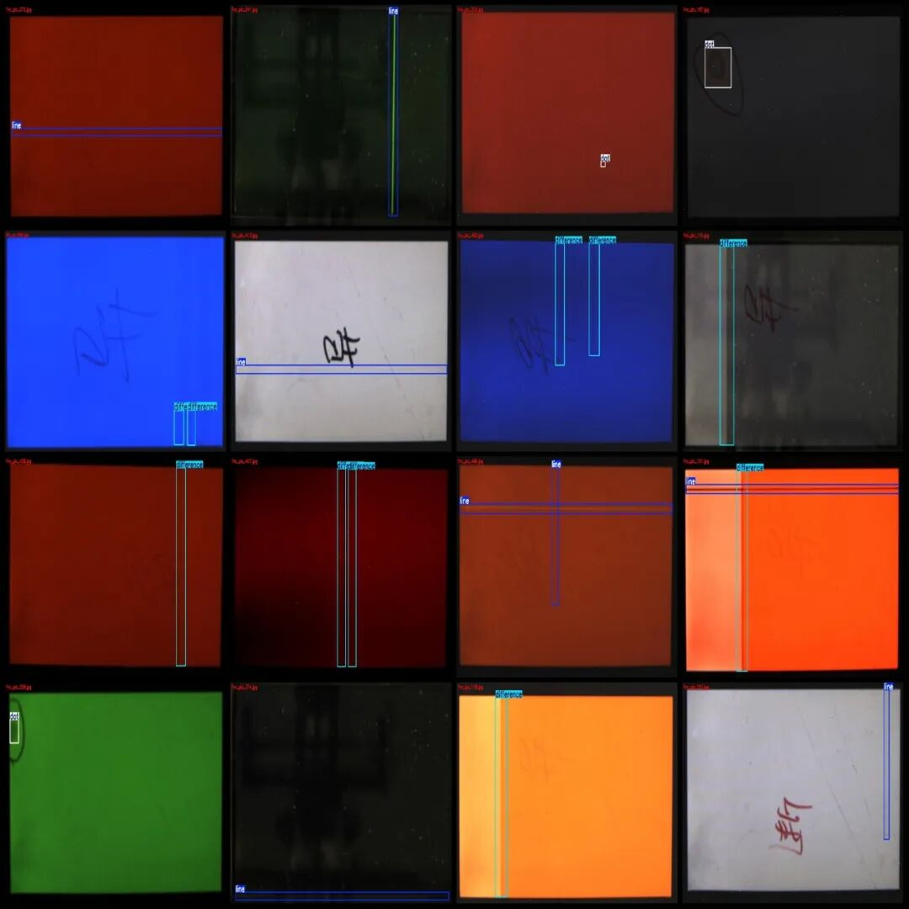
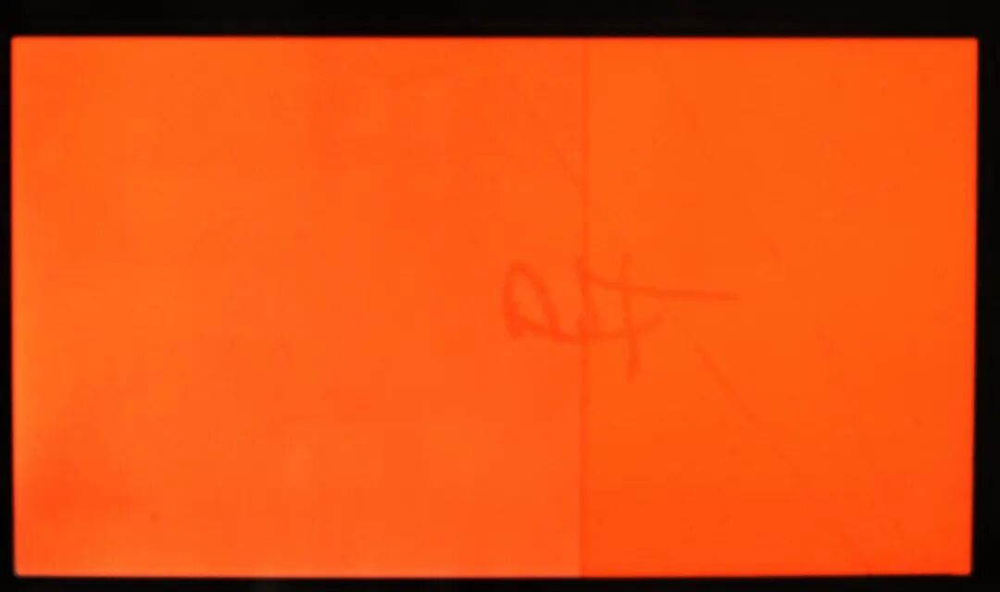
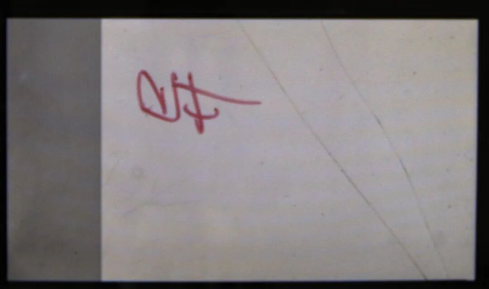
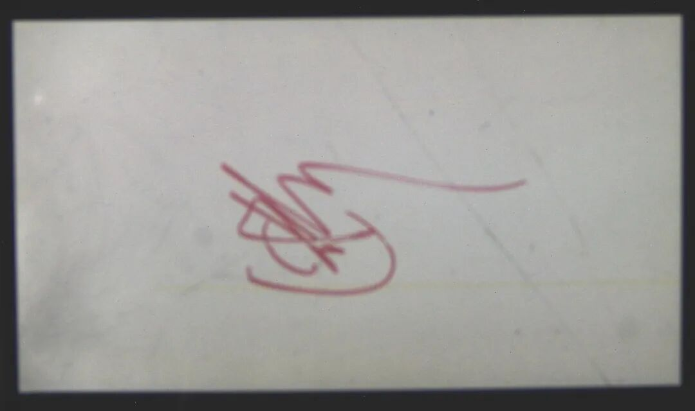

# Industrial Quality Inspection Screen Defect Detection Dataset VOC+YOLO format with 616 images in 4 categories

Dataset format: Pascal VOC format + YOLO format (txt file without split path, only containing jpg images and corresponding VOC format xml files and yolo format txt files)

Number of images (number of jpg files): 616

Number of annotations (number of xml files): 616

Number of annotations (number of txt files): 616

Labeling category count: 4

Label category names (note that the order of yolo format categories does not correspond to this, but is based on the labels folder's classes.txt): ["damage", "difference", "dot", "line"]

Number of boxes and the number of images occupied by each category:

Damage (damage) frame count = 16, occupy image count = 16

Difference (difference) Frames = 280, Frames of Pictures = 226

Dot (point) count = 59, occupying picture count = 54

Line (frame) count = 448, occupying picture count = 355

Total frame count: 803

Image resolution: 1736x1030

Using labelImg:

Annotation rules: Draw a rectangle around the category.

Important Notice: The dataset does not have separate training, validation, and test sets; you need to partition them yourself.

Special : This dataset does not guarantee the accuracy of the trained models or weight files.

Image Preview:

Annotation example:

Single image:

## Payment

Here is a pay link on Stripe ( https://buy.stripe.com/3cs8yP7sY87d0vu9AB ). Please contact me lonlonago@foxmail.com after funding $89, and I will send you a complete data files , thank you!

